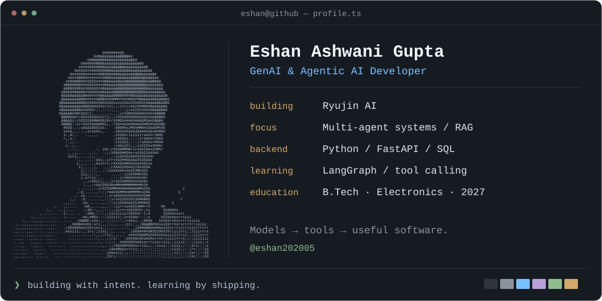
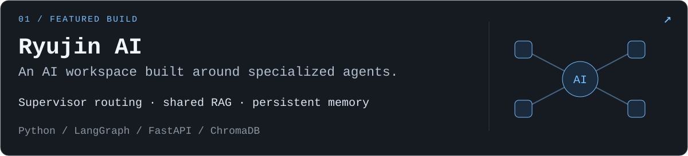
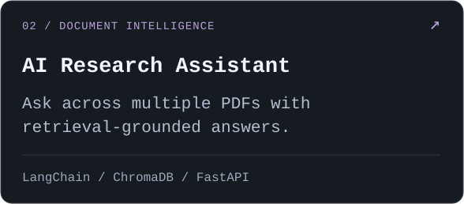
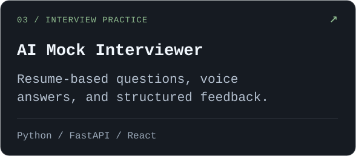
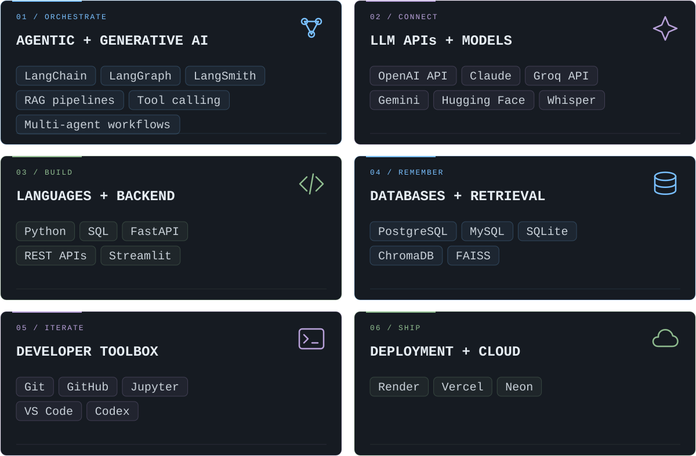
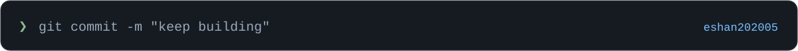

  

I build AI applications that connect language models, tools, and data — from document research to stateful agent workflows.

[`ls projects/`](https://github.com/eshan202005?tab=repositories) &nbsp; · &nbsp; [`cd ryujin-ai/`](https://github.com/eshan202005/Ryujin-AI)

### `01 / projects`

  

  
  

### `02 / toolkit`

**CS foundations:** Data Structures & Algorithms · Object-Oriented Programming · DBMS · Operating Systems · Computer Networks

### `03 / learning`

From retrieval pipelines to stateful agents — building projects to understand the systems underneath.

[LangChain experiments](https://github.com/eshan202005/Langchain-learning-and-basics) · [LangGraph and agentic AI](https://github.com/eshan202005/Mastering-LangGraph-and-Agentic-AI) · [All repositories](https://github.com/eshan202005?tab=repositories)

 

