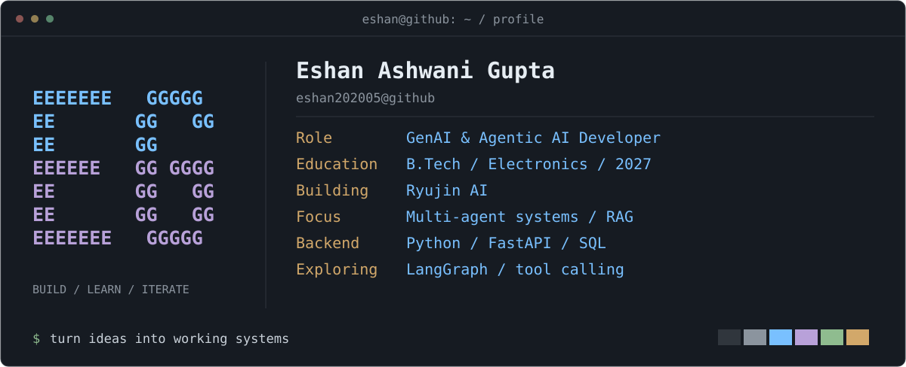
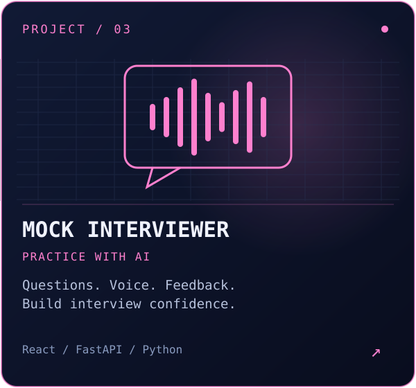

  

I build AI applications that connect language models, tools, and data — from document research to stateful agent workflows.

[`ls projects/`](https://github.com/eshan202005?tab=repositories) &nbsp; · &nbsp; [`cd ryujin-ai/`](https://github.com/eshan202005/Ryujin-AI)

### `01 / projects`

  
  
  

| Project | What it does |
| :--- | :--- |
| **[Ryujin AI](https://github.com/eshan202005/Ryujin-AI)** | Brings specialized agents, shared RAG, and persistent memory into one AI workspace. |
| **[AI Research Assistant](https://github.com/eshan202005/AI-Research-Assitant)** | Turns multiple PDFs into a searchable knowledge base with a FastAPI backend and retrieval pipeline. |
| **[AI Mock Interviewer](https://github.com/eshan202005/AI-Mock-Interviewer-Modern-)** | Combines resume-based questions, voice and text answers, coding practice, and AI evaluation. |

### `02 / toolkit`

**CS foundations:** Data Structures & Algorithms · Object-Oriented Programming · DBMS · Operating Systems · Computer Networks

### `03 / learning`

From retrieval pipelines to stateful agents — building projects to understand the systems underneath.

[LangChain experiments](https://github.com/eshan202005/Langchain-learning-and-basics) · [LangGraph and agentic AI](https://github.com/eshan202005/Mastering-LangGraph-and-Agentic-AI) · [All repositories](https://github.com/eshan202005?tab=repositories)

 

