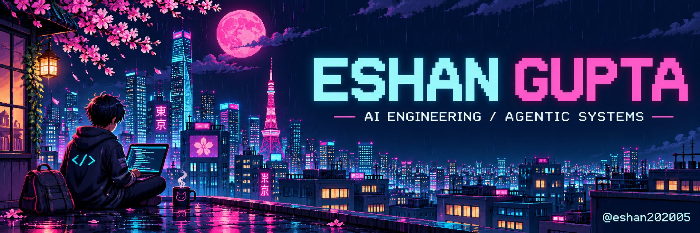
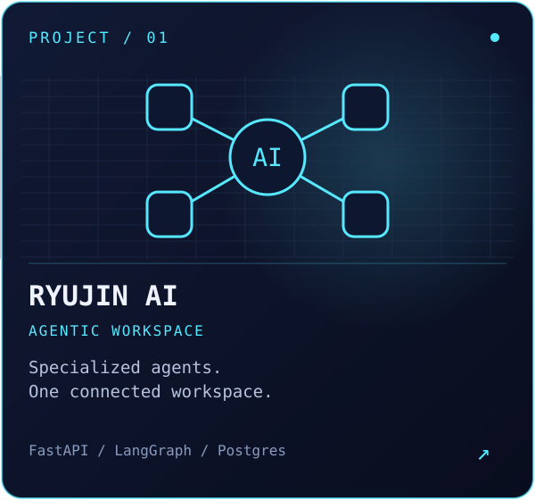
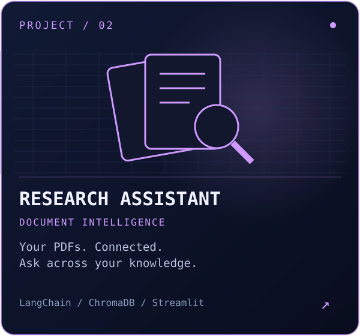
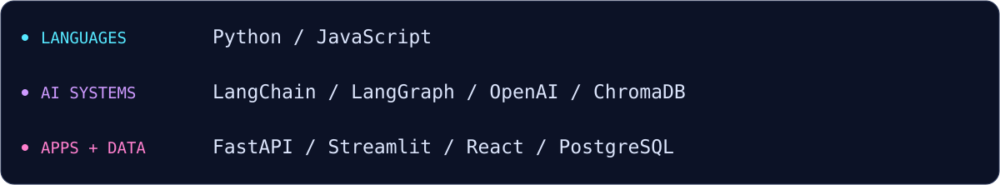
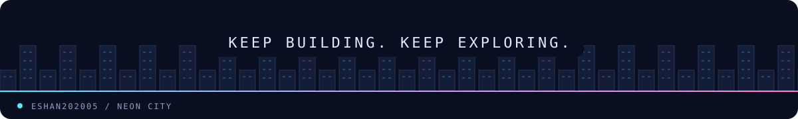

  

<h1 align="center">Hey, I'm Eshan 👋</h1>

  Building AI tools that turn ideas into working systems. 
  <b>Agents · RAG · Python · Full-stack AI</b>

  <a href="https://github.com/eshan202005?tab=repositories">Explore my repos ↗</a>
  &nbsp; / &nbsp;
  <a href="https://github.com/eshan202005/Ryujin-AI">Meet Ryujin AI ↗</a>

---

### `01 / ABOUT THE BUILDER`

I'm **Eshan Ashwani Gupta**. I build with Python and explore how language models, retrieval, and agent workflows fit together in useful applications.

- **Building:** Ryujin AI — an AI workspace with agent orchestration, shared retrieval, and persistent memory.
- **Exploring:** LangGraph, tool use, and the architecture behind agentic systems.
- **Also making:** document research tools and AI-powered interview practice.

### `02 / FEATURED BUILDS`

  
  
  

| Project | What it does |
| :--- | :--- |
| **[Ryujin AI](https://github.com/eshan202005/Ryujin-AI)** | Brings specialized agents, shared RAG, and persistent memory into one AI workspace. |
| **[AI Research Assistant](https://github.com/eshan202005/AI-Research-Assitant)** | Turns multiple PDFs into a searchable knowledge base with a FastAPI backend and retrieval pipeline. |
| **[AI Mock Interviewer](https://github.com/eshan202005/AI-Mock-Interviewer-Modern-)** | Combines resume-based questions, voice and text answers, coding practice, and AI evaluation. |

### `03 / TOOLKIT`

### `04 / LEARNING IN PUBLIC`

From retrieval pipelines to stateful agents — building projects to understand the systems underneath.

[LangChain experiments](https://github.com/eshan202005/Langchain-learning-and-basics) · [LangGraph and agentic AI](https://github.com/eshan202005/Mastering-LangGraph-and-Agentic-AI) · [All repositories](https://github.com/eshan202005?tab=repositories)

 

